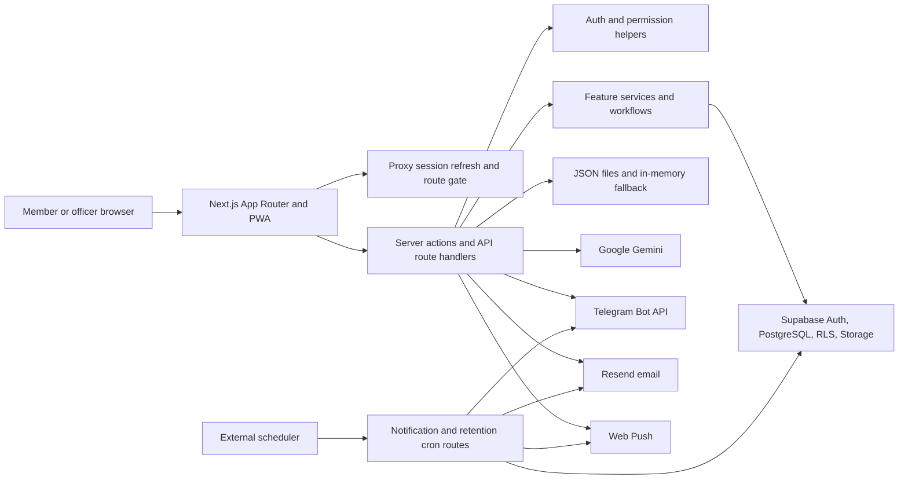
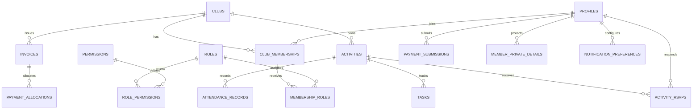

# 01 — System Overview

## What's done well

- The project is organized as a modular monolith, keeping feature actions, queries, UI, and business services in one deployable application.
- Supabase migrations are the database source of truth; the schema includes membership, permissions, activities, treasury, and notification domains.
- The app has explicit server-only Supabase admin boundaries and source-level unit and end-to-end test suites.

## Repository map

```text
racspeed-fe/
  src/
    app/                 App Router pages, auth pages, layouts, and API routes
    components/          Shared layout, permission, and UI components
    features/            Activities, members, treasury, tasks, events, and other domains
    lib/                 Auth, Supabase clients, services, validators, utilities, documents
  supabase/
    migrations/          PostgreSQL schema, authorization policies, and feature migrations
    config.toml          Local Supabase configuration
  tests/
    unit/                Vitest and Testing Library tests
    e2e/                 Playwright workflow test
  docs/                  Architecture, database, security, deployment, and operations guides
  scripts/               Admin bootstrap utility
racspeed-be/
  README.md              Pointer to backend code in racspeed-fe
```

Generated directories, `node_modules`, and local environment files were excluded from the map.

## Stack and classification

| Area | Detected stack |
|---|---|
| Product | RacSpeed, Rotaract Club Operations Platform; club administration and member operations |
| Application | Web app / PWA, Next.js App Router with server-rendered pages, server actions, and route handlers |
| Runtime/UI | Next.js 16.4.2, React 19.3.0, TypeScript 5, Tailwind CSS 4 |
| Data/auth | Supabase Auth and PostgreSQL via `@supabase/ssr` and `@supabase/supabase-js`; SQL migrations with RLS |
| Validation/forms | Zod 4, React Hook Form |
| Notifications/integrations | Resend, Web Push, Telegram Bot API, Google Gemini |
| Tests | Vitest 5, Testing Library, Playwright, axe-core dependency |
| Hosting model | Documentation describes Vercel and Supabase; actual production deployment was not verified |

Versions above are the declared package versions/ranges, not a certification of production deployment.

## Feature inventory (source-level)

| Area | Status | Evidence / qualification |
|---|---|---|
| Registration and approval | Partial | Registration and pending-approval pages/actions exist; email confirmation and password recovery were not found in the app routes. |
| Member directory and roles | Partial | Membership and permission modules exist; SEC-001/SEC-002 show server-side authorization gaps in adjacent modules. |
| Events and attendance | Present, needs production validation | Event actions, QR check-in API, attendance sessions, rate-limit helper, and workflow tests exist. |
| Project Center and reporting | Present, needs production validation | Activity/project workflows, report schemas, media, comments, and tests are present. |
| Treasury and budgets | Present, needs integration validation | Invoices, payment submissions, budgets, and workflow modules are represented in code and migrations. |
| Recruitment and retention | Present, needs production validation | Recruitment and retention pages/actions and scheduled retention route exist. |
| Tasks, resources, partnerships | Partial | Database-backed paths coexist with file/seed fallbacks; see DATA-001. |
| Notifications | Partial | In-app, push, email, and Telegram paths exist; Resend is optional and delivery requires scheduled processing. |
| Dashboard analytics | Partial / illustrative | Several displayed values and charts are hard-coded; see UX-001. |
| Legal, account recovery, and deletion | Not verified / incomplete in app routes | Registration has consent copy, but no linked privacy notice or account deletion route was found in the inspected route inventory. |

## Key journeys traced from source and tests

1. **Request membership:** public landing page → registration form and consent → `registerApplicantAction` → pending-review confirmation.
2. **Officer operations:** authenticated shell → events/projects/members → feature actions and queries → Supabase admin/SSR clients and RLS-protected tables.
3. **QR attendance:** event screen creates/shows a check-in token → `/api/attendance/check-in` validates request → attendance records and event membership.
4. **Activity reporting:** Project Center activity lifecycle → report draft/validation → publish and reporting snapshot/export.
5. **Notification delivery:** app/API queues delivery → authenticated cron claims batches → provider (Telegram/email/push) → delivery status.

The journeys are traced from source structure and selected tests/docs; a live database/browser flow was not exercised.

## Current architecture



The architecture is a **modular monolith** with server-side route handlers/actions and a PostgreSQL-backed service layer. `LocalFallback` represents code paths, not a recommended persistence design.

## Conceptual data model



This is a conceptual view synthesized from migration names, documented relationships, and inspected schema findings; it is not a generated ERD.

## History and hotspots

- Latest observed commit: `7b752cc` (`2026-11-26`, notification SLA and Telegram work).
- 68 commits were recorded in the year before the audit date.
- Most frequently changed paths in that window: `src/components/layout/sidebar.tsx` (16), `src/features/activities/actions.ts` (15), `src/app/(app)/project-center/[activityId]/activity-detail-client.tsx` (14), `src/app/(app)/events/events-client.tsx` (12), and `src/app/(app)/project-center/project-center-client.tsx` (11).
- The churn report is a risk indicator only; no complexity score was computed.

## Audit snapshot caveat

The worktree was already dirty. During the audit, more uncommitted activity changes and a recurrence migration appeared. They were left untouched and excluded from detailed review; the migration audit covers the 18 migration files present at its review snapshot.
