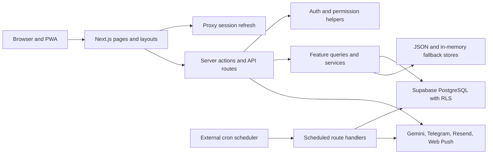
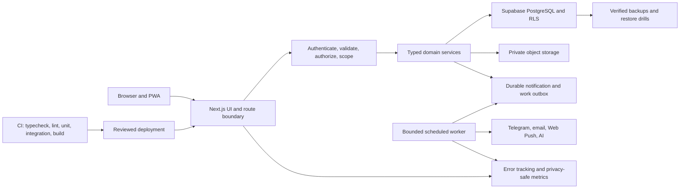

# 05 — Architecture and Data

## What's done well

- A modular monolith is appropriate for a small club operations team and keeps deployment simple.
- Supabase/PostgreSQL is the stated system of record, with migrations, RLS, private helper functions, and explicit role/permission tables.
- Business concerns have feature folders, shared validation, server-only integrations, and some pure workflow modules.
- Notification delivery uses an outbox/claim pattern, and attendance data has deduplication constraints.

## Current architecture

## Target architecture

The target retains Next.js and Supabase. It removes production file persistence, centralizes authorization at the server boundary, and adds tested delivery/operations controls rather than introducing microservices.

## Findings

### High — DATA-001: File and in-memory fallbacks are treated as production persistence

- **Confidence:** High
- **Location:** `src/lib/data/tasks-storage.ts:13-16,140-167`; `src/features/tasks/queries.ts:29-58`; `src/features/tasks/actions.ts:151-196`; `src/lib/data/partnerships-storage.ts`; `src/features/partnerships/actions.ts:100-152`.
- **Evidence:** Task reads fall back to seeded JSON when Supabase errors or returns zero rows; writes update a process-local/file store and catch filesystem errors. Supabase writes are best-effort and action results can still say `success: true`.
- **Impact:** On serverless/read-only or multi-instance deployments, changes can disappear between invocations. Empty databases may appear to contain sample data; a database outage can return stale state. A successful response may not mean the database committed the change.
- **Recommendation:** Make Supabase the only production source of truth; keep fixtures in tests/dev seed tools. Check every Supabase `{ error }`, return a surfaced failure on write failure, and use transactions/RPC for multi-step changes where needed. Gate any development fallback explicitly to non-production.
- **Plan task:** P0-T06 and P1-T02.

### Medium — ARCH-001: Service-role access concentrates authorization risk in application code

- **Confidence:** High
- **Location:** `src/lib/supabase/admin.ts`; `src/features/*/actions.ts`; `src/features/*/queries.ts`.
- **Evidence:** The shared admin client uses the Supabase service-role key; feature queries/actions use it for privileged operations, bypassing normal user RLS checks.
- **Impact:** Every server action/query becomes a security boundary. Missing a role or record-scope check has a wider effect than a user-scoped client.
- **Recommendation:** Keep server-role access only where necessary, require an explicit policy/ownership check at each call site, and prefer user-scoped clients for reads that should obey RLS.
- **Plan task:** P1-T04.

## Data model and API design

- Core entities include clubs/profiles/memberships, roles/permissions, activities/RSVPs/attendance, tasks/media, treasury records, and notification preferences/deliveries.
- The database docs describe club-scoped records, sensitive member details, centavo-based application math, and deduplication keys. The migration review found RLS on core tables and helper functions isolated under `private`.
- Route handlers are conventional Next.js endpoints with Zod validation in many routes. No OpenAPI contract or versioned API surface was found; this is acceptable at current scale, but shared request/response schemas should remain the source of truth.
- Audit behavior, transaction boundaries, and migration rollback behavior need a production integration review. Never use a live linked database during that review.

## Scale, reliability, and migration path

- **10× risk:** unbounded task/resource reads, whole-table access through service-role queries, fallback seed data, and no central route/provider metrics.
- **100× risk:** global service-role use, single-tenant/default-club assumptions, third-party rate limits, and cron/outbox backlog without alerting.
- **Reliability strengths:** delivery claims use a database function; Telegram webhook updates have duplicate protection; provider code has bounded request timeouts in some paths.
- **Reliability gaps:** broadcast generation lacks timeout/limits; file writes and swallowed database errors can report false success.
- **Incremental path:** (1) close authorization gaps and test; (2) make database writes authoritative and remove production JSON fallbacks; (3) add query pagination and observability; (4) validate multi-club isolation and restore procedures; (5) scale workers only when measured volume requires it.
- **Lock-in/cost:** Supabase and Vercel are meaningful platform dependencies; Gemini has direct quota/cost exposure. The existing modular monolith minimizes current operational cost.
