# 09 — Implementation Plan

Tasks are sized for a small PR (target ≤1 engineer-day). Estimates assume one or two engineers; team size, deployment process, and production status are unknown. Do not run migrations against a linked or production database without explicit environment confirmation and review.

## Phase 0 — Stabilize and secure

### P0-T01 — Upgrade Next.js to a patched compatible release

- **Status:** ✅ Done (2026-11-28, commit 5e677a0)
- **Resolves:** OPS-001
- **Why now:** At audit time, the production build exited after compilation because the installed Next.js version triggered a security block.
- **Files likely touched:** `package.json`, `package-lock.json`, possibly Next.js config.
- **Steps:** Review the official advisory; select a patched compatible release; update package/lock through the package manager; run build, typecheck, unit tests, and smoke tests.
- **Acceptance criteria:** Build completes without the security fatal; no unrelated dependency drift; core tests pass.
- **Tests to add:** Build check in CI (P1-T07).
- **Verification:** Build, typecheck, unit tests, and a local production health smoke check passed; lint remains at its pre-existing baseline. A clean Windows install needed the temporary test workaround recorded in OPS-005.
- **Effort:** M · **Risk:** Medium · **Depends on:** — · **Rollback:** revert the dependency/lockfile PR.

### P0-T02 — Authorize resource and partnership initiative mutations

- **Status:** ✅ Done (2026-11-28, commit 269931a)
- **Resolves:** SEC-001
- **Why now:** Existing server actions are callable outside the visible controls and perform privileged writes.
- **Files likely touched:** `src/features/resources/actions.ts`, `src/features/partnerships/actions.ts`, focused tests.
- **Steps:** Define required permission per action; call server-side auth/permission helpers; validate identifiers and fields; return explicit errors.
- **Acceptance criteria:** General members cannot create/update/delete resources or initiatives; authorized officers can perform allowed operations.
- **Tests to add:** Unauthorized and authorized cases for each mutation.
- **Verification:** Four focused authorization tests pass; typecheck and production build pass. Scoped lint still reports pre-existing `any` errors in resource actions; see the verification notes in `06-testing-and-operations.md`.
- **Effort:** M · **Risk:** Medium · **Depends on:** — · **Rollback:** revert the PR; no schema change.

### P0-T03 — Restrict task checklist mutations to assignees or managers

- **Status:** ✅ Done (2026-11-28, commit ae419ee)
- **Resolves:** SEC-001
- **Why now:** Authenticated users can toggle/add checklist items without task ownership or permission checks.
- **Files likely touched:** `src/features/tasks/actions.ts`, task action tests.
- **Steps:** Load the target task; enforce assigned-member or `TASK_MANAGE` scope; ensure the selected checklist belongs to that task; keep authorization and mutation in one trusted flow.
- **Acceptance criteria:** Unassigned members are rejected; authorized assignees/managers can update only permitted tasks.
- **Tests to add:** Cross-user and unknown task/item cases.
- **Verification:** Five regression tests pass after failing before the fix; typecheck and production build pass. Scoped lint has the same 11 pre-existing errors as the parent branch.
- **Effort:** S · **Risk:** Low · **Depends on:** — · **Rollback:** revert the PR.

### P0-T04 — Bind sister-club mutations to authorized club ownership

- **Resolves:** SEC-002
- **Why now:** The current check and target record ID are not bound together.
- **Files likely touched:** `src/features/partnerships/actions.ts`, partnership tests.
- **Steps:** Fetch target `home_club_id`; authorize the caller for that exact club; include club scope in update/delete predicates; avoid leaking target existence.
- **Acceptance criteria:** A club officer cannot update/delete another club's record by substituting IDs.
- **Tests to add:** Club A/club B isolation cases for update and delete.
- **Effort:** S · **Risk:** Low · **Depends on:** — · **Rollback:** revert the PR.

### P0-T05 — Protect Gemini generation from unauthorized and unbounded use

- **Resolves:** SEC-003, PERF-002
- **Why now:** An open route can spend the configured Gemini quota.
- **Files likely touched:** `src/app/api/broadcasts/generate/route.ts`, rate-limit helper, focused route tests.
- **Steps:** Require intended user permission; validate body and cap prompt length; rate-limit; set abort timeout; remove caller-provided server credential path; map failures to safe responses.
- **Acceptance criteria:** Anonymous/unauthorized, oversized, over-limit, and timeout requests fail safely; valid users still get a draft.
- **Tests to add:** Route authorization, schema, rate-limit, timeout, and provider error cases.
- **Effort:** M · **Risk:** Medium · **Depends on:** — · **Rollback:** revert route changes; provider key remains server-side.

### P0-T06 — Make task writes authoritative and disable task seed fallback

- **Resolves:** DATA-001, CODE-002
- **Why now:** Users can see seeded data or receive success when writes were not durable.
- **Files likely touched:** `src/lib/data/tasks-storage.ts`, `src/features/tasks/queries.ts`, `src/features/tasks/actions.ts`.
- **Steps:** Keep fixtures dev/test-only; use Supabase as the production source of truth; check returned `{ error }`; fail visibly on write failure; remove production file writes/fallbacks.
- **Acceptance criteria:** Empty/error database states never return demo tasks in production; failed mutations return failure; successful tasks survive process restart and multiple instances.
- **Tests to add:** Empty DB, error DB, failed write, and restart/integration cases.
- **Effort:** M · **Risk:** High · **Depends on:** — · **Rollback:** restore the previous read path only behind a non-production guard.

### P0-T07 — Narrow private member data access policies

- **Resolves:** SEC-004, SEC-005
- **Why now:** Sensitive row permissions are broader than documented and shared-club profile selection exposes email.
- **Files likely touched:** New Supabase migrations, member data service, RLS integration tests, security docs.
- **Steps:** Confirm intended field visibility; introduce least-privilege view/RPC or policy structure; limit self-service updates; test two-member/two-club behavior.
- **Acceptance criteria:** Private fields are only readable/editable by the approved actors; directory reads expose only approved fields.
- **Tests to add:** RLS tests using separate authenticated users and roles.
- **Effort:** M · **Risk:** Medium · **Depends on:** owner policy decision · **Rollback:** add a forward corrective migration; do not edit an applied migration.

### P0-T08 — Remove fixed example cron credential from production use

- **Resolves:** SEC-007
- **Why now:** The tracked example value satisfies production's current minimum-length check and protects cron routes.
- **Files likely touched:** `.env.example`, `src/lib/env.ts`, cron route tests, deployment docs.
- **Steps:** Replace the fixed value with an empty/example placeholder; generate a deployment secret; reject known local/example values in production; document scheduler setup.
- **Acceptance criteria:** Production cannot start with the example credential; invalid cron requests remain unauthorized and a generated secret works.
- **Tests to add:** Production env schema rejects the known example; both cron routes reject invalid bearer tokens.
- **Effort:** S · **Risk:** Low · **Depends on:** — · **Rollback:** revert validation only after a secure secret is configured.

### P0-T09 — Replace partnership and resource file persistence

- **Resolves:** DATA-001, CODE-002
- **Why now:** Partnerships/resources can fall back to seeded or process-local state and silently succeed after database write failures.
- **Files likely touched:** `src/lib/data/partnerships-storage.ts`, `src/lib/data/resources-storage.ts`, `src/features/partnerships/actions.ts`, `src/features/partnerships/queries.ts`, `src/features/resources/actions.ts`, `src/features/resources/queries.ts`.
- **Steps:** Keep fixtures in dev/test only; make Supabase the production source of truth; check returned errors; return explicit failures for unsuccessful writes; remove production file fallbacks.
- **Acceptance criteria:** Production reads do not mix seeded rows into empty database results; failed writes are reported; successful records persist across processes.
- **Tests to add:** Empty/error DB, failed write, and multi-instance/restart cases for both domains.
- **Effort:** M · **Risk:** High · **Depends on:** — · **Rollback:** use a non-production-only compatibility fallback if required.

### P0-T10 — Make database permission revocation authoritative

- **Resolves:** SEC-008
- **Why now:** Local role defaults are added to effective permissions after database grants are loaded, so a revocation may not take effect consistently.
- **Files likely touched:** `src/lib/auth/session.ts`, `src/lib/data/role-permissions-storage.ts`, `src/features/permissions/actions.ts`, authorization tests.
- **Steps:** Use database grants as the effective permission set when the query succeeds; fail closed if authorization data is unavailable; check all database errors and report incomplete permission updates.
- **Acceptance criteria:** Removing a permission in the database removes it on every application instance; role-save errors never return success.
- **Tests to add:** Revoke a built-in permission, simulate stale local defaults/read-only filesystem, and verify authorization is denied.
- **Effort:** M · **Risk:** Medium · **Depends on:** — · **Rollback:** revert with revocation regression tests retained.

## Phase 1 — Foundations

### P1-T01 — Align auth settings and test account recovery policy

- **Resolves:** SEC-006
- **Why now:** Local auth config differs from the registration form and production policy is unknown.
- **Files likely touched:** `supabase/config.toml`, auth tests, deployment docs.
- **Steps:** Confirm production policy; align local settings; document recovery/verification redirect setup.
- **Acceptance criteria:** Local auth behavior matches the documented target; no production setting is changed without owner confirmation.
- **Effort:** S · **Risk:** Low · **Depends on:** — · **Rollback:** revert config/docs.

### P1-T02 — Add persistence and authorization regression tests

- **Resolves:** OPS-003, DATA-001, SEC-001, SEC-002
- **Files likely touched:** `tests/unit/`, local Supabase integration tests/config.
- **Steps:** Add focused action tests first; add RLS and write-failure tests with a disposable local DB; record how to run them.
- **Acceptance criteria:** P0 authorization changes include failing-before/fixed-after action tests; integration cases validate RLS and persistence after the related fixes.
- **Effort:** M · **Risk:** Low · **Depends on:** P0-T02–P0-T10 · **Rollback:** revert test-only PR.

### P1-T03 — Reduce lint errors in bounded feature batches

- **Resolves:** CODE-001
- **Files likely touched:** Files reported by ESLint, split into separate PRs.
- **Steps:** Start with React render/effect errors; then types/unsafe casts; then warnings. Avoid broad rule suppression.
- **Acceptance criteria:** Each batch removes its targeted diagnostics without new ones; total baseline trends down.
- **Effort:** M per batch · **Risk:** Low · **Depends on:** — · **Rollback:** revert the affected batch.

### P1-T04 — Type permission boundaries and make fallback behavior explicit

- **Resolves:** CODE-003, ARCH-001
- **Files likely touched:** `src/lib/auth/session.ts`, permission query/services.
- **Steps:** Replace nested `any` payloads with generated/typed models; validate role values; document and gate development-only fallbacks.
- **Acceptance criteria:** No unchecked casts in the touched authorization path; Supabase failures are visible and do not silently broaden access.
- **Effort:** M · **Risk:** Medium · **Depends on:** P0 authorization tasks · **Rollback:** revert with prior permission tests retained.

### P1-T05 — Replace starter README with product setup instructions

- **Resolves:** CODE-004
- **Files likely touched:** `README.md`
- **Steps:** Document purpose, prerequisites, safe local setup, environment variables, test commands, and links to existing docs.
- **Acceptance criteria:** A new developer can find the canonical setup and does not receive stale create-next-app directions.
- **Effort:** S · **Risk:** Low · **Depends on:** — · **Rollback:** revert docs.

### P1-T06 — Add privacy-safe error and operations telemetry

- **Resolves:** OPS-004, PERF-003
- **Files likely touched:** app instrumentation, provider/cron wrappers, deployment docs.
- **Steps:** Select an approved provider; capture route/provider duration, errors, queue age and cron health; redact tokens/member content; define alerts.
- **Acceptance criteria:** A failed cron/provider operation is observable without logging secrets or sensitive payloads.
- **Effort:** M · **Risk:** Medium · **Depends on:** — · **Rollback:** disable telemetry integration.

### P1-T07 — Add CI quality gates

- **Resolves:** OPS-002
- **Files likely touched:** `.github/workflows/`, package scripts if needed.
- **Steps:** Run typecheck and unit tests on pull requests; add build after P0-T01; gate lint when CODE-001 baseline is addressed.
- **Acceptance criteria:** CI uses lockfile-based install and fails on command failures; no credentials or production services are required.
- **Effort:** S · **Risk:** Low · **Depends on:** P0-T01 · **Rollback:** revert workflow.

## Phase 2 — Quality and UX

### P2-T01 — Replace dashboard sample metrics with source-backed data

- **Resolves:** UX-001, FEAT-003
- **Files likely touched:** dashboard server query/client and unit tests.
- **Acceptance criteria:** Each metric has a documented source and the selected date range changes the result; no sample values ship as live.
- **Effort:** M · **Risk:** Medium · **Depends on:** P0-T06 · **Rollback:** retain prior dashboard behind a temporary feature flag.

### P2-T02 — Fix form labels and dashboard text selection

- **Resolves:** A11Y-001, UX-002
- **Files likely touched:** login/register pages, dashboard client, accessibility tests.
- **Acceptance criteria:** Every input has an associated label and autocomplete; dashboard content is selectable; axe/keyboard checks pass for these pages.
- **Effort:** S · **Risk:** Low · **Depends on:** — · **Rollback:** revert UI change.

### P2-T03 — Standardize loading, empty, and error states

- **Resolves:** UX-003
- **Files likely touched:** shared empty/error/loading components and one feature per PR.
- **Acceptance criteria:** Each audited feature has a useful empty state and recoverable error state; no fallback data masquerades as live content.
- **Effort:** M per feature · **Risk:** Low · **Depends on:** P0-T06 · **Rollback:** revert feature-level UI PR.

### P2-T04 — Paginate and narrow task queries

- **Resolves:** PERF-001
- **Files likely touched:** task query, UI pagination/cursor state, migration only if required.
- **Acceptance criteria:** Task listing is bounded, ordered stably, and returns only fields used by the view.
- **Effort:** M · **Risk:** Medium · **Depends on:** P0-T06 · **Rollback:** restore prior query with safe upper limit.

## Phase 3 — Feature evolution

### P3-T01 — Add verified email and password recovery

- **Resolves:** FEAT-001
- **Effort:** M · **Depends on:** P1-T01 · **Acceptance criteria:** recovery/verification links work locally and production redirects are documented and tested.

### P3-T02 — Add member privacy-request intake

- **Resolves:** FEAT-002
- **Effort:** M · **Depends on:** owner retention/legal decision · **Acceptance criteria:** members can submit and track a permission-scoped export/deletion request; requests are auditable.

### P3-T05 — Implement approved export and deletion requests

- **Resolves:** FEAT-002
- **Effort:** M · **Depends on:** P3-T02 and owner retention/legal decision · **Acceptance criteria:** approved requests honor retention exceptions and produce an auditable completion record.

### P3-T03 — Add comprehensive audit history for high-impact actions

- **Resolves:** FEAT-004
- **Effort:** M · **Depends on:** P1-T04 · **Acceptance criteria:** role, finance, membership approval, and sensitive changes record actor/time/action with redaction.

### P3-T04 — Add a guided first-run setup checklist

- **Resolves:** FEAT-005
- **Effort:** M · **Depends on:** P1-T05 · **Acceptance criteria:** officers can confirm initial setup without entering secrets into application data.

## Phase 4 — Scale and differentiate

- Add capacity work only from measured route/query/Web Vitals baselines (OPS-004, PERF-003).
- Validate club-level isolation across every query and action before expanding to multiple independent clubs (SEC-002, ARCH-001).
- Add restore drills and queue-backlog runbooks before scaling external delivery workers (OPS-004).

## Dependency flow

```mermaid
flowchart TD
  P0T01[P0-T01 Patch Next.js] --> P1T07[P1-T07 CI]
  P0T02[P0-T02 Resource and initiative permissions] --> P1T02[P1-T02 Regression tests]
  P0T03[P0-T03 Task checklist authorization] --> P1T02
  P0T04[P0-T04 Club ownership scoping] --> P1T02
  P0T05[P0-T05 Gemini route limits] --> P1T02
  P0T06[P0-T06 Durable task writes] --> P2T01[P2-T01 Trusted dashboard data]
  P0T06 --> P2T03[P2-T03 UI data states]
  P0T06 --> P2T04[P2-T04 Bounded task query]
  P0T09[P0-T09 Partnership and resource persistence]
  P0T10[P0-T10 Authoritative permission revocation] --> P1T02
  P0T08[P0-T08 Secure cron credential] --> P1T07[P1-T07 CI]
  P0T07[P0-T07 Private-data policy] --> P1T02
  P1T01[P1-T01 Auth settings] --> P3T01[P3-T01 Account recovery]
  P1T04[P1-T04 Typed authorization] --> P3T03[P3-T03 Audit history]
  P1T05[P1-T05 Product README] --> P3T04[P3-T04 Onboarding]
  P3T02[P3-T02 Privacy request intake] --> P3T05[P3-T05 Execute approved requests]
```

## Rough timeline

For one or two engineers, with review and deployment approvals: Phase 0 **1–2 weeks**; Phase 1 **2–3 weeks**; Phase 2 **1–2 weeks**; Phase 3 **3–6 weeks** depending on policy decisions; Phase 4 **ongoing, measurement-led**. This assumes no major production data migration; confirm against team availability.

## Definition of Done

- Tests relevant to the change pass; new authorization/data-path behavior has focused regression tests.
- Typecheck and lint are clean for touched code; CI is green.
- No new warnings, unsafe fallbacks, or secret values are introduced.
- Documentation and findings register are updated.
- Database changes use a new reviewed migration and are tested only on a disposable environment.
- No production/external side effects occur without explicit approval.

## Deliberately not doing (yet)

- No framework rewrite or microservice split: the modular monolith fits the current product stage.
- No blanket caching: authorization and invalidation semantics need to be explicit first.
- No advanced analytics or AI expansion until dashboard truth, authorization, quota controls, and measurement are in place.
- No legal conclusion about compliance; the club owner must confirm retention, privacy notice, and applicable obligations.
- No source/dependency changes were made during the initial audit; implementation tasks are recorded separately above.
